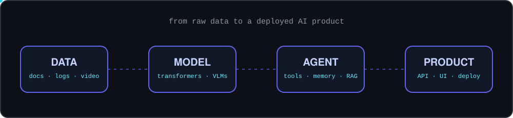

 

  

---

## 🧠 What I build

- **LLM applications:** RAG chatbots and assistants that answer from your own documents
- **Agentic AI:** agents that use tools and carry out multi-step tasks, including on the desktop
- **Deep learning and vision-language models:** models that understand text, images and video
- **Full products:** Java and Spring Boot backends, REST APIs and web interfaces around the AI

---

## 🚀 Featured projects

| Project | What it is | Focus |
|---|---|---|
| **TeacherOS** | Online coaching and school platform | Full stack |
| **AI Fault Investigator** | AI model that investigates faults and helps trace likely causes | Machine learning |
| **B2B Sourcing CRM** | CRM built for B2B sourcing workflows | Full stack |
| **Agentic Desktop Agent** | AI agent that carries out tasks on the desktop | Agentic AI |
| [**Nexa AI**](https://github.com/deepak-sjd/nexa-ai) | Conversational assistant using Gemini and RAG | LLM, RAG |
| [**Portfolio**](https://github.com/deepak-sjd/deepak-portfolio) | My personal portfolio website | Next.js, Spring Boot |

<!-- TODO: for each project above without a link, make its repo public and link it:
     [**Name**](https://github.com/deepak-sjd/REPO-NAME) -->

---

## 🧰 Tech stack

---

## 🌐 Find me

- 🌍 Portfolio: [deepak-portfolio-theta-brown.vercel.app](https://deepak-portfolio-theta-brown.vercel.app/)
<!-- TODO: add your Fiverr profile link here when you are ready to share it -->

*Have an AI idea or a problem to automate? Message me, and I'll tell you honestly whether I can help.*

